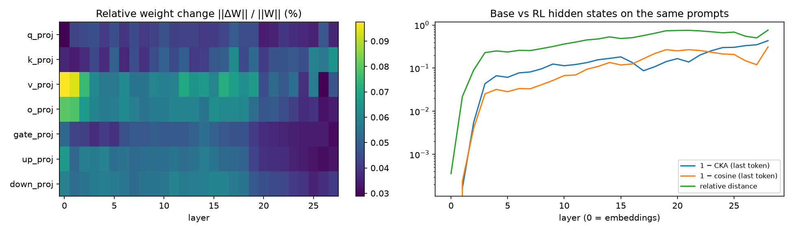

# rl-diff-lite: what does RL change inside a small reasoning model?

A first, cheap look at a base model and its RL-from-base checkpoint, using only weights and
forward passes (no training). Pairs:

| Size | Base | RL-from-base (SimpleRL-Zoo, GSM8K/MATH rule-based reward) |
|---|---|---|
| 1.5B | `Qwen/Qwen2.5-1.5B` | `hkust-nlp/Qwen-2.5-1.5B-SimpleRL-Zoo` |
| 0.5B | `Qwen/Qwen2.5-0.5B` | `hkust-nlp/Qwen-2.5-0.5B-SimpleRL-Zoo` |

The RL checkpoint's `config.json` records `Qwen2.5-1.5B` as its starting point, so the two models
differ only by RL training.

## Findings

**1. RL left most weights untouched, and the update is small.**
At bf16 (the base checkpoint's storage precision), **89.5%** of the 1.5B model's parameters are
bit-identical before and after RL (**84.6%** for 0.5B). Per weight matrix, the relative change
‖ΔW‖/‖W‖ averages about **0.05%** (1.5B) and **0.07%** (0.5B).

**2. The largest edits are in the earliest attention value/output projections.**
In both sizes, the five most-changed matrices are all `v_proj` or `o_proj` in layers 0–2
(1.5B: layer 0 `v_proj` 0.097%, layer 1 `v_proj` 0.094%, layer 0 `o_proj` 0.080%). Late layers
change less (1.5B: 0.058% mean in layers 0–1 vs 0.040% in layers 24–27).

**3. ΔW has a few dominant directions but is not low-rank.**
The median stable rank of ΔW is 3.3, yet keeping 99% of its energy needs a median of 73% of the
full rank.

**4. Tiny weight edits grow into large representation differences with depth.**
On 200 GSM8K prompts, the base and RL hidden states at the last prompt token have cosine
similarity **0.9998 after layer 1**, about **0.73 by layers 19–21**, and **0.69 at the last layer**
(1.5B; 0.5B ends at 0.51). Over all 14,416 prompt positions, the two models agree on the top-1 next
token **82.6%** of the time (0.5B: 80.0%).

**5. Under a plain prompt, accuracy barely moves; what changes is how the model stops.**
Greedy decoding, 512 new tokens, prompt `Question: … Answer: Let's think step by step.`, first 200
GSM8K test questions, same answer-extraction rule for both models:

| 1.5B | GSM8K accuracy | Raw output tokens | Words before the model starts a new question |
|---|---|---|---|
| Base | 63.0% | 345 | 61.5 |
| RL | 64.5% | 240 | 90.2 |

The accuracy difference is +1.5 points with a paired-bootstrap 95% CI of [−5, +8] points, so it is
not distinguishable from zero here. The base model tends to keep going after its answer and invent a
new `[Question]`; the RL model writes longer reasoning and then stops.



## Caveats

- One prompt format. SimpleRL-Zoo trains and reports with its own template and `\boxed{}` answers,
  so its published accuracy gains are not expected to appear under this plain prompt.
- "Bit-identical at bf16" depends on precision: updates smaller than one bf16 step count as unchanged.
- Everything here is correlational. It shows *where* the models differ, not *which* differences
  cause the behaviour change.
- Mean-pooled CKA (in the JSON) stays near 1 until late layers. It is dominated by a few very large
  activations, so the last-token metrics are the informative ones.

## Next step

Activation patching: run the base model but swap in the RL model's output at one layer (and the
reverse), and measure how much of the behaviour change, such as stopping after the answer, each
layer carries. That tests whether the early `v_proj`/`o_proj` edits matter, or whether the effect is
spread across depth.

## Reproduce

```bash
python download.py 1.5b 0.5b      # ~13 GB into ./models
python weight_diff.py --size 1.5b
python activations.py --size 1.5b --n 200
python gen_eval.py --size 1.5b --n 200 && python rescore.py 1.5b
python plot.py 1.5b
```

Run on an Apple Silicon Mac (MPS), PyTorch 2.11, transformers 5.4.
